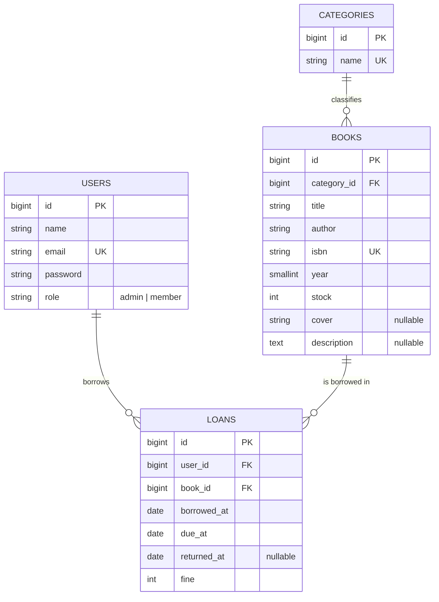

# Database design

## Conceptual model (ERD)

Paste the diagram into <https://mermaid.live> to export it as PNG/SVG for the report.

## Physical model (data dictionary)

### users
| Column | Type | Constraints |
|---|---|---|
| id | BIGINT UNSIGNED | PK, auto increment |
| name | VARCHAR(255) | NOT NULL |
| email | VARCHAR(255) | NOT NULL, UNIQUE |
| email_verified_at | TIMESTAMP | NULL (unused) |
| password | VARCHAR(255) | NOT NULL (bcrypt hash) |
| role | VARCHAR(20) | NOT NULL, default `member` |
| remember_token | VARCHAR(100) | NULL |
| created_at, updated_at | TIMESTAMP | NULL |

### categories
| Column | Type | Constraints |
|---|---|---|
| id | BIGINT UNSIGNED | PK |
| name | VARCHAR(100) | NOT NULL, UNIQUE |
| created_at, updated_at | TIMESTAMP | NULL |

### books
| Column | Type | Constraints |
|---|---|---|
| id | BIGINT UNSIGNED | PK |
| category_id | BIGINT UNSIGNED | **FK -> categories.id**, ON DELETE RESTRICT |
| title | VARCHAR(200) | NOT NULL |
| author | VARCHAR(150) | NOT NULL |
| isbn | VARCHAR(20) | NOT NULL, UNIQUE |
| year | SMALLINT UNSIGNED | NOT NULL |
| stock | INT UNSIGNED | NOT NULL, default 1 |
| cover | VARCHAR(255) | NULL (path inside storage/app/public) |
| description | TEXT | NULL |
| created_at, updated_at | TIMESTAMP | NULL |

### loans
| Column | Type | Constraints |
|---|---|---|
| id | BIGINT UNSIGNED | PK |
| user_id | BIGINT UNSIGNED | **FK -> users.id**, ON DELETE CASCADE |
| book_id | BIGINT UNSIGNED | **FK -> books.id**, ON DELETE RESTRICT |
| borrowed_at | DATE | NOT NULL |
| due_at | DATE | NOT NULL |
| returned_at | DATE | NULL (NULL means still on loan) |
| fine | INT UNSIGNED | NOT NULL, default 0 (Rupiah) |
| created_at, updated_at | TIMESTAMP | NULL |

### Relationships
- One **category** has many **books** (1:N); a book belongs to exactly one category.
- One **user** has many **loans** (1:N).
- One **book** has many **loans** (1:N).
- Users and books are therefore in a many-to-many relationship, resolved by `loans`.

### Business rules
- A loan lasts 7 days; a user may hold at most 3 active loans and may not hold two copies of the same book.
- Borrowing decreases `books.stock` by 1, returning increases it by 1 (both inside a DB transaction).
- Fine = days late x Rp 1.000, calculated when the book is returned.
- A category with books, or a book with loan records, cannot be deleted (protects data integrity).
